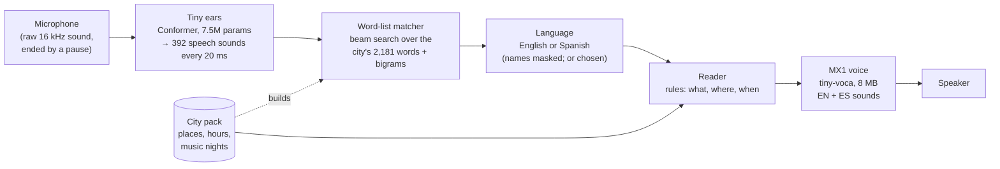

# tiny-speech

**Private voice questions and answers in the browser, in English and Mexican Spanish, in about 17 MB.**

You ask a question out loud ("¿Dónde hay tacos al pastor?", "Is La Azotea open now?"). The page hears it, works out what
you asked, answers from the city's own data, and speaks the answer in the language you used. Everything runs on your phone
or computer: no server, no cloud speech service, no per-question cost, and nothing you say leaves your device.

**Try it:** https://larsboesen-prog.github.io/tiny-speech/demo/ (allow the microphone, or type, or tap an example).

It was built for [MapSMA](https://mapsma.com), a guide to restaurants, bars, live music and sights in San Miguel de Allende,
Mexico, and is shared with CredBrief, a news site. A city is data, not code: adding a city needs no training.

## Why

The usual way to add voice to a website is to send the visitor's recording to a cloud speech service and the answer to a cloud
voice. That costs money for every question, needs a server, and sends people's voices to a third party. Small open models
that run in the browser exist, but the common ones are either too big for a phone's first visit (Whisper tiny, the smallest
Whisper, is about 40 MB and still mishears Mexican Spanish place names) or speak English only.

tiny-speech is two small models trained for this job, and a rule-based reader between them:

| Part | What it does | Size | Before |
|---|---|---|---|
| **Tiny ears** (`engines/ears/`) | speech to text, English + Spanish, for the city's words | 8.9 MB model + 0.4 MB word list | Whisper tiny, about 40 MB; Spanish place names often wrong |
| **Reader** (`domains/`, `core/`) | question → request → answer from the city's data; rules, no AI model at run time | a few hundred KB | the same (unchanged) |
| **MX1 voice** (`vendor/tiny-voca/tiny-voca-mx1-2026-11-21.gguf`) | text to speech, English + Mexican Spanish, one voice for both | 8.0 MB | tiny-voca, English only; the phone's own voice for Spanish |

A visit downloads about 29 MB the first time (17 MB compressed), including the 10.6 MB onnxruntime-web engine that runs the
ears; the browser keeps the files for later visits. The page's earlier setup with Whisper tiny was 75–130 MB.

## How it works



1. **Listen** (`browser/listen.js`, `browser/pcm-worklet.js`): the microphone's raw sound, no echo cancellation, ended by
   700 ms of silence or after 5 seconds.
2. **Hear** (`browser/asr-worker.js` → `engines/asr-ears.js`, in a worker): the tiny ears do not write words. Every 20 ms they
   say which of 392 speech sounds (IPA phones, both languages) they hear. A small matcher (`engines/ears-match.js`) then finds
   the most likely sentence made of **the city's own words** (2,181 for San Miguel: place names, dishes, areas, everyday
   question words in both languages) with a two-word language model. That is why it hears "Raindog Cantina" or "Bocaciega",
   which a general model writes as something else, and why it is so small: the model only has to hear sounds; the words come
   from the city. When an accent turns a name into other words ("Is Estoril open?" written "is it open"), the name finder
   (`engines/ears-spot.js`) still looks for each of the city's names in the sounds themselves; the page then answers about the
   clear winner or offers the two or three closest names as buttons.
3. **Decide the language** (`core/lang-decide.js`): from the words, with the city's names masked out first ("Is La Azotea
   open?" is English though "la" is Spanish), and the last question's language. The visitor can choose instead.
4. **Read and answer** (`domains/places/`, `domains/music/`): rules turn the words into a request ("open now", "near the
   Jardín", "tacos", "tonight", "4 more") and answer it from the city pack: opening hours in the city's time zone, distances,
   curated picks, live music nights. No language model runs here, so answers are repeatable and never made up.
5. **Speak** (`browser/tinyvoca-js-worker.js` → `engines/tinyvoca-js.js`, in a worker): MX1, a warm Mexican guide's voice,
   reads the answer sentence by sentence (the first sentence plays while the next is made), Spanish with Spanish sounds and
   English with English sounds, in the same voice.

Details: `ARCHITECTURE.md` (decisions, layers, sizes, the build plan), `browser/README.md` (the browser files and their
messages), `models/` (model cards).

## Accuracy

Read these with one caveat in mind: **every voice in the speech tests is synthetic** (Piper text-to-speech voices). The ears
have not yet been measured on real Mexican speakers; that is the next test (5–10 consented speakers). The numbers say the design
works and beats the alternatives on the same clips, not how it will do on every phone in a noisy bar.

### Speech to text: Mexican Spanish restaurant and music requests

72 held-out requests (two Mexican Piper voices; the sentences were never in training):

| | Understood exactly as said | The thing asked for heard right | Words wrong | Place names found |
|---|---|---|---|---|
| **Tiny ears, 8.9 MB** | **80.6%** | **46 of 52** | **8.8%** | 9 of 12 |
| The large recognizer it learned from (wav2vec2, 1.2 GB) | 58.3% | 33 of 52 | 32.7% | 10 of 12 |
| Whisper tiny (about 40 MB), as the sites used it | 29.2% | 12 of 52 | 47.7% | 6 of 12 |

The same 144 sentences read by two voices it **never heard** in training (Argentina, Spain):

| | Understood exactly as said | The thing asked for heard right | Words wrong | Place names found |
|---|---|---|---|---|
| **Tiny ears** | **85.4%** | **96 of 108** | **11.6%** | 24 of 32 |
| The large recognizer | 65.3% | 84 of 108 | 23.6% | 22 of 32 |
| Whisper tiny | 52.1% | 62 of 108 | 25.5% | 18 of 32 |

- **Language** decided right for 93.8% of those clips (Whisper tiny 97.2%); the page also has an English / Español switch.
- **English** (retrained 22 Nov 2026 with English requests read by about 1,000 English voices): on 201 English requests read by
  three voices it never heard, understood **88.1%** (the first model 67.2%, Whisper tiny.en 61.2%), words wrong 10.1%, places found
  89 of 93; questions using everyday words, 87.8%. Mexican Spanish improved with it (87.5% → 91.0%); two non-Mexican Spanish voices
  lost a little (86.1% → 82.6%). `models/ears.md` has every number.
- **Names said with an accent** (names by sound, 22 Nov 2026): on 560 stand-in clips of five non-native English voices (Danish,
  German, Swedish, French, Belgian Dutch) and two native ones asking about 40 San Miguel places, names found 370 → **402**, and 81
  more offered as a button (86% found or one tap away); a wrong place 14 → 10. On 659 ordinary English and Spanish questions it adds
  no wrong answer. `training/asr/probe/README.md` has the method; `record-names/` records your own voice for the same test
  (`tools/names-test.mjs`).
- **Speed**: 0.2–0.5 s to turn a 3-second question into text on one CPU core (Whisper tiny: about 2 s).
- **Closed vocabulary**: it can only write words in the city's list. A word outside the list comes out as the nearest list
  word, or not at all. That is what makes it accurate for the city, and why it is not a general dictation model.

### The reader

On 301 unexpected questions written by a language model (122 English, 120 Spanish, 59 mixing both), the reader understood
something it could answer from (a topic, a time, a place, a price) in 98%, 100% and 98%, and took the language right every time.
Given 384 names misheard on purpose ("Noodle" for Nudol), it found the right place for 96% (`test/llm/REPORT.md`). The extra
words it learned came from those same sets, so fresh sets are the fair next test. 1,756 recorded answers are checked on every
change (`test/golden/`).

### The voice

MX1 was checked by having Whisper small listen to sentences it had never read in training:

| | Spanish words heard right | English words heard right | Language heard right |
|---|---|---|---|
| Training gates (PyTorch, 200 sentences a language) | 96.7% | 94.1% | 100% / 98.5% |
| **The browser engine, the 8 MB file** (40 sentences a language) | **96.5%** | **96.2%** | 100% |

It runs about 4× faster than real time on one CPU core; the first sound comes 0.5–1 s after the answer. Most words Whisper
writes differently are names ("Cambay" for Kan Bei). The voice is designed, not recorded: no real person's voice was copied.

## Use it

### Try it on your computer

```sh
git clone https://github.com/larsboesen-prog/tiny-speech
cd tiny-speech
python3 -m http.server 8000      # any static file server
# open http://localhost:8000/demo/
```

The microphone works on `localhost` and on HTTPS pages. onnxruntime-web comes from cdn.jsdelivr.net (a site can serve its own
copy: `browser/README.md`, "Serving the engine files from the site itself").

### In your own page

The demo (`demo/demo.js`, about 270 lines) is the smallest complete example. The two workers:

```js
// speech to text: the tiny ears with a city's word list
const ears = new Worker("/tiny-speech/browser/asr-worker.js?ears=/tiny-speech/engines/ears/ears-int8-2026-11-22.onnx"
  + "&lexicon=/tiny-speech/packs/dist/mx-sma/ears-lexicon.json", { type: "module" });
ears.postMessage({ type: "load", model: "tiny-ears" });                       // → {type: "ready"}
ears.postMessage({ type: "transcribe", reqId: 1, model: "tiny-ears", audio }); // Float32Array, 16 kHz → {type: "text", text}

// text to speech: MX1, English or Spanish
const voice = new Worker("/tiny-speech/browser/tinyvoca-js-worker.js?model=/tiny-speech/vendor/tiny-voca/tiny-voca-mx1-2026-11-21.gguf"
  + "&sha256=921d4f8406fd7f988541c5a5487e5b8712740440a93f2f68b836baec4e1a07c6", { type: "module" });
voice.postMessage({ type: "load" });                                          // → {type: "ready", voices: ["F2", "M2", "MX1"]}
voice.postMessage({ type: "speak", id: 1, sentences: ["Hola."], voice: 2, lang: "es" }); // → {type: "sentence", audio, sampleRate} …, {type: "done"}
```

Both workers keep their files in the browser's Cache Storage and check the voice file's SHA-256 before use. Whisper tiny stays
available in the same worker (`model: "onnx-community/whisper-tiny"`) for open-ended questions such as news.

### A new city

A city is a folder of JSON (`packs/src/<city>/`: places, hours, areas, curated lists, music nights; the San Miguel folder is
the example). Then:

```sh
node tools/build-pack.mjs <city>     # checks it and writes packs/dist/<city>/
node tools/ears-lexicon.mjs <city>   # the tiny ears' word list for that city
```

No model is retrained: the ears hear sounds, and the city's words come from its pack.

### Tests

```sh
npm install && npx playwright install chromium && npm test   # Node 20+
```

`test/demo.test.mjs` plays a recorded Spanish question into the demo through a fake microphone and checks what is heard, the
answer, the voice, and that no request carries sound or text.

## Training (free GPU time)

Both models were trained on Kaggle's free T4 GPUs (30 hours a week), from notebooks in this repository:

- **Tiny ears** (`training/ears/`): about 108 hours of free speech (Mexican Spanish from CIEMPIESS, Latin American Spanish
  requests to a voice assistant from Google, US English from LibriSpeech, and synthetic restaurant requests). The small model
  learns to give the same sound probabilities as a large recognizer (facebook/wav2vec2-lv-60-espeak-cv-ft, 300M parameters)
  and to match the Spanish transcripts. 10.7 GPU hours.
- **MX1 voice** (`training/gpu/`, `training/voice/`): a Mexican voice designed from a written description with Qwen3-TTS
  VoiceDesign, then Qwen3-TTS Base read 6,941 English and Spanish sentences in that voice, and tiny-voca's own training
  taught the 8 MB model to speak them. About 15 GPU hours (3¼ to make the recordings, 11 to train).

The sentences for training and testing were written at build time with a language model (about $7); nothing calls one at run
time.

## Licences and credits

| What | Licence |
|---|---|
| The code | Apache License 2.0 (`LICENSE`) |
| The tiny ears model, `engines/ears/ears-int8-2026-11-22.onnx` (and the earlier `-2026-11-20`) | **CC BY-SA 4.0**: it learned from CC BY-SA speech. See `models/ears.md` |
| The MX1 voice, `vendor/tiny-voca/tiny-voca-mx1-2026-11-21.gguf` | Apache License 2.0. See `models/voice.md` |
| tiny-voca's JavaScript engine and phonemizer, `vendor/tiny-voca/js/` | Apache License 2.0, Muhammed Nazeem |
| San Miguel's pack, `packs/` | MapSMA's listings (mapsma.com), shared here under Apache License 2.0 for the demo and tests. Hours and music nights are a snapshot: check before you go |

Built on:

- **tiny-voca** by Muhammed Nazeem (github.com/n4ze3m/tiny-voca, Apache-2.0): the voice model, its training code and its
  plain-JavaScript engine. MX1 is tiny-voca grown to Spanish and to a third speaker.
- **Qwen3-TTS** by the Alibaba Qwen team (Apache-2.0): designed MX1's voice and read its training sentences.
- **wav2vec2-lv-60-espeak-cv-ft** by Meta AI (Apache-2.0): the large recognizer the tiny ears learned from.
- **CIEMPIESS** Light, Balance and Fem corpora by Carlos Daniel Hernández Mena and colleagues, UNAM (CC BY-SA 4.0).
- **Crowdsourced Latin American Spanish** speech by Google (OpenSLR 61, 71, 72; CC BY-SA 4.0).
- **LibriSpeech** by Vassil Panayotov, Guoguo Chen, Daniel Povey and Sanjeev Khudanpur (CC BY 4.0).
- **Piper** voices es_MX claude and ald (rhasspy/piper; Apache-2.0 and CC0 data): synthetic training and test requests.
- **onnxruntime-web** by Microsoft (MIT), loaded from jsDelivr; **Whisper** by OpenAI (MIT) through transformers.js
  (Apache-2.0), still an option.
- The curated picks in San Miguel's pack are Susan York's (cupcakesandcrablegs.com); their short notes credit and link her posts
  and are hers, not ours to license.

`NOTICE` lists the same in the form the Apache licence asks for.
